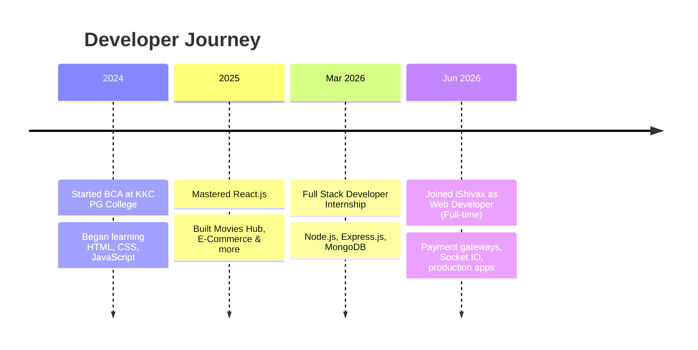

<div align="center">


<a href="https://github.com/dronpareek7-art">
  
</a>

<br/>

[](https://www.linkedin.com/in/drona-pareek/)
[](https://github.com/dronpareek7-art)
[](mailto:dronpareek7@gmail.com)
[](https://www.instagram.com/dron_pareek)
[](https://wa.me/919983736942)


</div>

---

## 👨‍💻 About Me

```javascript
const drona = {
  name:       "Drona Pareek",
  location:   "Jaipur, Rajasthan 🇮🇳",
  currentRole: "Web Developer @ iShivax (Full-time, since Jun 2026)",
  education:  "BCA @ KKC PG College (CGPA: 8.5/10)",
  stack:      ["React.js", "Node.js", "Express.js", "MongoDB", "REST APIs"],
  experienceWith: ["Razorpay", "CCAvenue", "Socket.IO", "WordPress", "Firebase"],
  funFact:    "I turn coffee ☕ into clean, performant UIs"
};
```

I'm a **Web Developer** who builds and ships full-stack applications — from responsive React interfaces to Node.js/Express APIs backed by MongoDB. I started with frontend, went through a full-stack internship, and now work full-time on **real production applications**: integrating payment gateways, building real-time features and maintaining live systems.

- 💼 Working full-time as a **Web Developer at iShivax** since June 2026
- 💳 Integrated **Razorpay** & **CCAvenue** payment gateways
- ⚡ Built real-time features with **Socket.IO**
- 🔐 Experience with **Firebase Authentication** & **REST API** integrations
- 📊 Built interactive data visualizations using **Chart.js**
- 🎯 Focused on clean code, component-based architecture & performance-first UI

---

## 💼 Experience

| Role | Company | Duration | Type |
|---|---|---|---|
| **Web Developer** | **iShivax** — Jaipur, Rajasthan | Jun 2026 – Present | Full-time · On-site |
| **Full Stack Developer (Intern)** | **Full Stack Learning** — Jaipur, Rajasthan | Mar 2026 – Jun 2026 | Internship · On-site |

<details open>
<summary><b>🏢 Web Developer @ iShivax &nbsp;|&nbsp; Jun 2026 – Present</b></summary>
<br/>

- Developed **frontend and backend features** using React.js, Node.js, Express.js and MongoDB
- Integrated **REST APIs**, **Razorpay**, **CCAvenue** and other third-party services
- Worked on **WordPress development**, **Socket.IO** and maintenance of real-world applications
- Gained hands-on experience in **debugging, database management and deployment workflows**

</details>

<details>
<summary><b>🎓 Full Stack Developer Intern @ Full Stack Learning &nbsp;|&nbsp; Mar 2026 – Jun 2026</b></summary>
<br/>

- Completed a 3-month Web Development internship with hands-on full-stack application development
- Worked with **Git & GitHub** for version control and collaboration

</details>

---

## 🛠️ Tech Stack

<div align="center">

| Category | Technologies |
|---|---|
| 🎨 **Frontend** |      |
| ⚙️ **Backend** |     |
| 🗄️ **Database** |   |
| 💳 **Integrations** |    |
| 🔧 **Tools & Deployment** |       |

</div>

---

## 🚀 Featured Projects

<table>
<tr>
<td width="50%" valign="top">

### 🎬 Movies Hub
`React.js` `TMDB API` `Firebase` `Context API`

- 500K+ movie & TV records via TMDB API
- Firebase Auth with persistent user watchlists
- Dynamic routing across 3 content categories
- Global state via Context API — no prop-drilling across 10+ components

[](https://movies-hub-black-phi.vercel.app)

</td>
<td width="50%" valign="top">

### 🛒 E-Commerce App
`React.js` `REST API` `Vercel`

- 50+ product storefront with cart management & checkout flow
- Skeleton loading screens — improved perceived load time by ~40%
- Reusable component architecture across 6 core UI sections

[](https://e-commerce-react-hrh7.vercel.app)

</td>
</tr>
<tr>
<td width="50%" valign="top">

### 💰 Budget Calculator
`React.js` `Chart.js` `Vercel`

- Real-time income/expense tracking with instant state updates
- Interactive pie & bar charts replacing manual spreadsheet tracking
- Fully responsive — mobile & desktop ready

[](https://budget-calculator-drab-seven.vercel.app)

</td>
<td width="50%" valign="top">

### 🎮 Pokémon World
`Vanilla JS` `PokeAPI` `CSS`

- Search, type filtering & paginated results via PokeAPI
- Interactive flip-card UI for Pokémon details
- 100% vanilla JS — zero frameworks

[](https://pokemon-world-alpha.vercel.app)

</td>
</tr>
</table>

<details>
<summary><b>🏆 More projects (click to expand)</b></summary>
<br/>

- **Scoreboard App** — React.js · live score updates with dynamic ranking sort · [Live Demo](https://scoreboard-react-jet.vercel.app)
- **43+ repositories** — HTML/CSS experiments, Tesla landing page clone, hover effects & animations · [View all →](https://github.com/dronpareek7-art?tab=repositories)

</details>

---

## 📈 My Journey



---

## 🎓 Education

| 🏫 Institution | 📚 Program | 📅 Year | 🏆 Score |
|---|---|---|---|
| KKC PG College, Churu (MGSU) | Bachelor of Computer Applications (BCA) | 2024 – Present | CGPA: 8.5 / 10 |

---

## 📊 GitHub Stats

<div align="center">


<br/>


</div>

---

## 🤝 Let's Connect

<div align="center">

*Always open to learning, collaborating and discussing ideas in **React · Node.js · Full Stack Development***

<br/>

[](https://www.linkedin.com/in/drona-pareek/)
&nbsp;
[](mailto:dronpareek7@gmail.com)
&nbsp;
[](https://www.instagram.com/dron_pareek)

<br/>

⭐ *If you like my work, drop a star on a repo — it motivates me to build more!*


</div>
